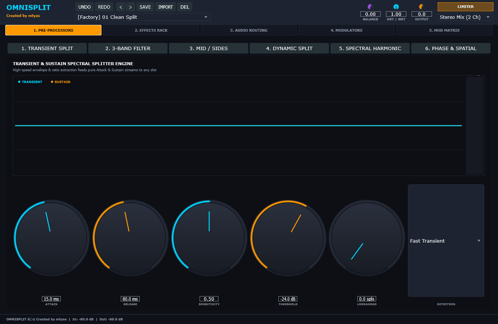
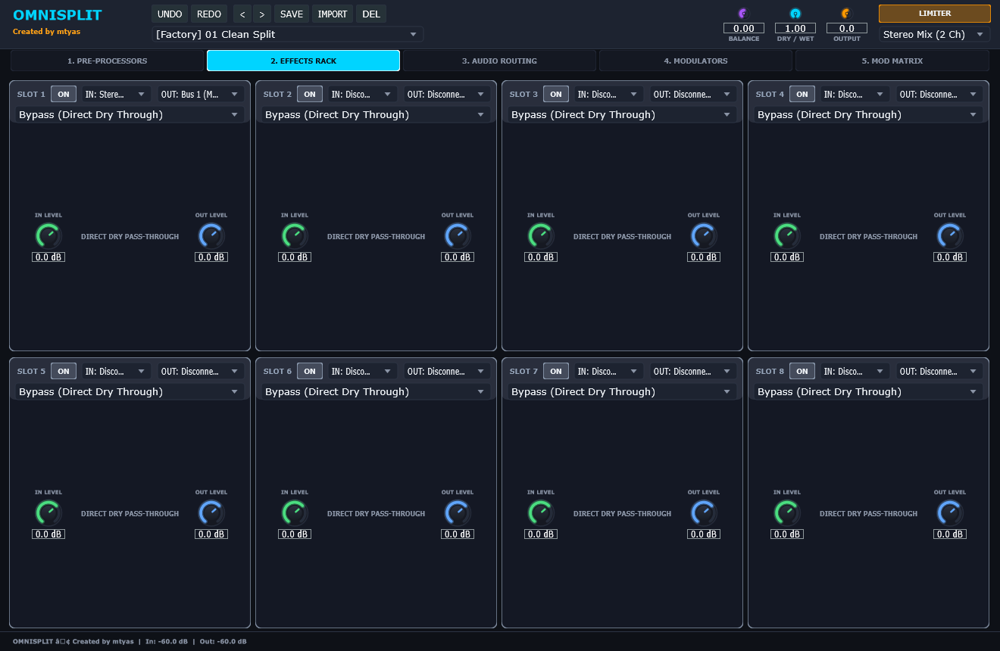
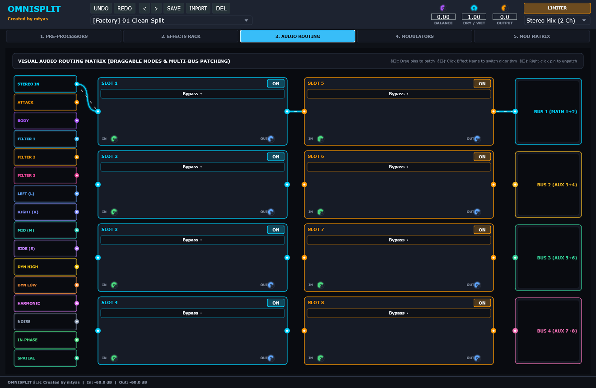
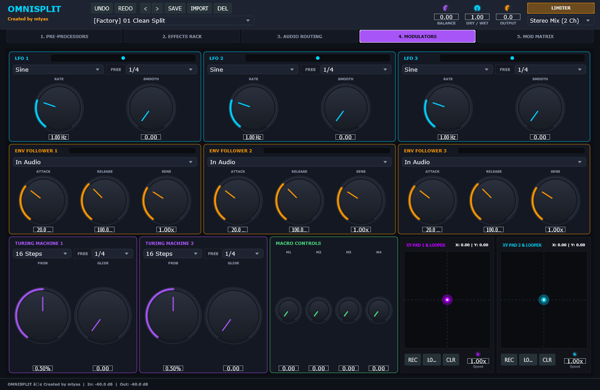
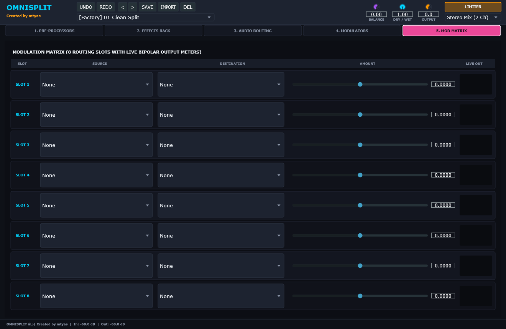

# 🎛️ OmniSplit: Multi-Domain Modular Audio Processing & Spectral Splitting Suite
### Developed by **mtyas** | VST3 • CLAP • AU • Standalone (Windows / macOS / Linux)

[](https://github.com/mtyas/OmniSplit/releases/latest)
[](MANUAL.md#effects-catalog)
[](https://github.com/free-audio/clap)
[]()
[](https://ko-fi.com/mtyas)

---

> ### ⚡ Quick Action & Links
> - [📥 **Download Latest Binaries (Windows / macOS / Linux)**](https://github.com/mtyas/OmniSplit/releases/latest)
> - [📖 **Read Full User Manual (`MANUAL.md`)**](MANUAL.md)
> - [🎛️ **Studio Ecosystem Routing (Pairs Well With)**](#-pairs-well-with-studio-ecosystem-synergy)
> - [✂️ **6 Multi-Domain Pre-Processor Splitters**](#-6-multi-domain-real-time-decomposition-splitters)

---

## 🔊 Sonic Transformation & Overview

**OmniSplit** is a modular sound design workstation and surgical mixing suite. Rather than applying effects across an entire audio signal, OmniSplit deconstructs incoming audio across **6 real-time physical and mathematical decomposition domains**:

1. **Transient / Sustain**: Separate the instantaneous impact click from the low-frequency resonant body.
2. **3-Band ZDF Filterbank**: Isolate Low, Mid, and High frequency bands with Zero-Delay Feedback state variable filters.
3. **Mid / Side Stereo**: Decouple centered in-phase mono power from wide out-of-phase stereo ambience.
4. **Dynamic Amplitude**: Split loud transient peaks from subtle background tails, room ambience, and ghost notes.
5. **Spectral Harmonicity**: Isolate steady tonal harmonic content from stochastic noise and breath textures.
6. **Phase / Spatial Correlation**: Separate phase-coherent mono signals from diffuse, decorrelated stereo fields.

Route each decomposed stream through an **8-slot modular effects rack** featuring **35 studio-grade DSP algorithms**—including analog tape saturators, Chebyshev wavefolders, granular reverse glitchers, FET compressors, and Dattorro shimmer reverbs. Patch and cable connections visually using an interactive DAG audio routing matrix, and modulate parameters with synchronized LFOs, envelope followers, and Turing machines.

---

## 📸 Interface & Visual Tour

<p align="center">
  
</p>

### 🔍 Detailed Interface Breakdown

| 6 Real-Time Pre-Processor Splitters | 8-Slot Modular Effects Rack |
| :---: | :---: |
|  |  |
| *Simultaneous extraction across Transient/Sustain, 3-Band ZDF, Mid/Side, Dynamic, Spectral, and Phase domains.* | *8 reorderable effect slots selectable across 35 DSP algorithms with independent input source selection and level staging.* |

| Interactive Visual DAG Cable Routing | Advanced Modulation Suite (LFOs, Turing, XY) |
| :---: | :---: |
|  |  |
| *Visual patch cords and DAG connection graph displaying multi-stream routing and inter-slot feedback/feedforward paths.* | *3 tempo-synced LFOs, 3 multi-source envelope followers, 2 Turing shift registers, and 2 loopable XY expression pads.* |

| 8-Slot Live Modulation Matrix | Full Sound Design Workspace |
| :---: | :---: |
|  |  |
| *Comprehensive drag-and-drop modulation matrix connecting any internal modulator to DSP parameters with bipolar depth.* | *Complete multi-bus output routing (Main 1+2, Aux 3+4, Aux 5+6, Aux 7+8) for surround and stem mixing.* |

---

## 🌟 Innovation Spotlight: Standout Breakthroughs

> [!IMPORTANT]
> ### ✂️ 6 Multi-Domain Real-Time Decomposition Splitters
> Conventional audio plugins only offer simple multiband crossovers. OmniSplit operates across 6 distinct physical and mathematical dimensions:
> - **Energy-Ratio Transient Splitter**: Isolates the attack click from sustain body with mathematical unity reconstruction.
> - **3-Band Zero-Delay Feedback (ZDF) Filterbank**: 3 fully parametric SVF channels (LP, HP, BP, Peak, Notch, Shelf) with zero delay.
> - **Mid/Side Linear Matrix**: Decouples mono fundamentals from stereo spatial width.
> - **Dynamic Ballistics Splitter**: Splits audio into High (Loud/Forte) vs Low (Quiet/Floor) with smooth soft-knee curves.
> - **Spectral Harmonicity Filterbank**: Separates pitched tonal harmonics from stochastic noise texture.
> - **Phase Correlation Estimator**: Isolates centered in-phase mono audio from wide decorrelated stereo ambience.

> [!TIP]
> ### 🔌 Interactive Visual Cable Patching & 25-Source Input Matrix
> Every slot in the 8-effect rack can independently listen to any of the 16 pre-processor split streams or feed from other effect slots. The **Interactive Audio Routing Diagram** lets you drag visual patch cables to build complex series, parallel, and feedback routing networks with zero latency penalty.

---

## 🎛️ Pairs Well With: Studio Ecosystem Synergy

OmniSplit is the ultimate downstream surgical processor for the **MTYAS Audio Suite**:

```
         +-----------------+  +-----------------+  +-----------------+
         | FORGE64 (Drums) |  | NeoOrgan (Org)  |  | CrossMod (Syn)  |
         | Multi-out stems |  | Leslie rotor    |  | Screaming FM    |
         +--------+--------+  +--------+--------+  +--------+--------+
                  |                    |                    |
                  | Kick Stem          | Stereo Rotor       | Complex Lead
                  +--------------------+--------------------+
                                       |
                                       v
                     +--------------------------------------+
                     |          OmniSplit (Audio FX)        |
                     | - Surgical Transient / Sustain Split |
                     | - Mid / Side & Spatial Decoupling    |
                     | - 8-Slot Modular Effects Rack        |
                     +--------------------------------------+
```

### 1. 🥁 FORGE-64 $\to$ OmniSplit (Surgical Kick Stem Transient & Body Decoupling)
- **Why It Pairs**: Applying heavy overdrive, bitcrushing, or wavefolding to a full kick drum ruins the sub-bass low end and creates phase-cancellation mud.
- **Workflow**: Route FORGE-64's **Kick Drum Out** into **OmniSplit**. Engage the **Transient Splitter**:
  - **Attack (Transient Click)**: The instantaneous initial click of the beater hitting the drumhead dictates the rhythm. Route this stream into OmniSplit's *Chebyshev Wavefolder* or *Bitcrusher* to slice through dense mixes with razor-sharp definition.
  - **Body (Sustain Boom)**: The low-frequency 50 Hz sub boom dictates the groove. Keep this stream completely clean and uncompressed, locking the sub-bass foundation with flawless phase coherence.

### 2. 🎪 Neo-Organ $\to$ OmniSplit (Rotary Speaker Mid/Side & Spatial Separation)
- **Why It Pairs**: The Leslie rotary speaker creates a lush, swirling stereo Doppler effect. However, heavy stereo modulation on low organ tonewheels creates center-image weakness.
- **Workflow**: Route Neo-Organ into OmniSplit. Use the **Mid/Side Splitter** or **Phase / Spatial Splitter**:
  - Keep the **Mid (In-Phase Mono)** channel clean and focused, centering the organ's fundamental 16' and 8' tonewheel frequencies.
  - Route the **Side (Spatial Out-of-Phase)** stream through OmniSplit's *Stereo Tape Echo* or *Dattorro Shimmer Reverb* for an enormous swirling halo that never weakens the mix center.

### 3. 🎛️ CrossMod $\to$ OmniSplit (Extreme Timbre Deconstruction)
- **Why It Pairs**: Extreme Through-Zero FM (TZFM) and oscillator sync produce aggressive high-frequency sidebands.
- **Workflow**: Route CrossMod into OmniSplit. Use the **Spectral Harmonicity Splitter** to separate the pure tonal pitched core from the noisy FM sidebands, applying pitch shifting or granular reverse delays exclusively to the inharmonic frequencies.

---

## 🧩 35 Studio-Grade DSP Algorithms

- **Dynamics**: VCA Compressor, Opto Compressor, FET Compressor, Noise Gate.
- **Equalizers & Filters**: 4-Band Parametric EQ, 8-Band Graphic EQ, Tilt EQ, Dual HP/LP ZDF Filter, Bandpass & Notch Filter.
- **Distortion & Saturation**: Hard Clipper, Tube Saturation, Wavefolder, Germanium Fuzz, Octave Fuzz, Overdrive, Analog Tape Saturation.
- **Glitch & Granular**: Bitcrusher, Stutter Repeater, Tape Stop Glitch, Reverse Slice, Granular Jitter.
- **Pitch & Modulation**: Pitch Shifter ($\pm 24\text{ st}$), Frequency Shifter, Multi-Voice Stereo Chorus, Flanger, 8-Stage Phaser, Tremolo / Auto-Pan.
- **Delays & Echo**: Stereo Delay, Ping-Pong Delay, Analog Tape Echo.
- **Reverberation**: Room Reverb, Hall Reverb, Plate Reverb, Spring Reverb, Dattorro Shimmer Reverb.

---

## 📦 Downloads & Installation

Pre-compiled production releases for Windows, macOS, and Linux are available from the [**Releases Page**](https://github.com/mtyas/OmniSplit/releases/latest):

| OS / Platform | Download Package | Included Formats | Architecture |
| :--- | :--- | :--- | :--- |
| **Windows** | [📥 **OmniSplit-v1.0.0-Windows.zip**](https://github.com/mtyas/OmniSplit/releases/download/v1.0.0/OmniSplit-v1.0.0-Windows.zip) | VST3, CLAP, Standalone (`OmniSplit.exe`) | x86_64 |
| **macOS** | [📥 **OmniSplit-v1.0.0-macOS-Universal.zip**](https://github.com/mtyas/OmniSplit/releases/download/v1.0.0/OmniSplit-v1.0.0-macOS-Universal.zip) | VST3, CLAP, AudioUnit (`.component`), Standalone (`OmniSplit.app`) | Universal (Apple Silicon & Intel) |
| **Linux** | [📥 **OmniSplit-v1.0.0-Linux-x64.zip**](https://github.com/mtyas/OmniSplit/releases/download/v1.0.0/OmniSplit-v1.0.0-Linux-x64.zip) | VST3, CLAP, Standalone | x86_64 |

---

## ⚙️ Architecture & Engineering Specifications

- **C++20 & JUCE 8 Framework**: Fully vector-optimized DSP pipeline.
- **Zero-Allocation Audio Thread**: 100% lock-free processing with zero dynamic allocations during playback.
- **Bit-Exact Complementary Reconstruction**: All 6 decomposition splitters sum back to the original source with mathematical unity.

### Building from Source

```bash
git clone --recursive https://github.com/mtyas/OmniSplit.git
cd OmniSplit
cmake -B build -DCMAKE_BUILD_TYPE=Release
cmake --build build --config Release --target OmniSplit_All
```

---

## ☕ Support & Community

If OmniSplit transforms your sound design, please consider supporting ongoing development:

[](https://ko-fi.com/mtyas)

---

## Support & Donations

To support my work and encourage me to do more, please consider leaving a tip at [https://ko-fi.com/mtyas](https://ko-fi.com/mtyas).

[](https://ko-fi.com/mtyas)

---

## 📄 License

Copyright © 2026 **mtyas**. All rights reserved.  
Crafted with [JUCE](https://juce.com) and [CLAP Extensions](https://github.com/free-audio/clap).